# docker-observium-arm64

**Observium против зоопарка ОС** — домашний мониторинг сети на [Observium
Community](https://www.observium.org/) в Docker для ARM64.

Собирает и запускает Observium — систему сетевого мониторинга по SNMP — в связке
с MariaDB. Стек: Ubuntu 22.04 + Apache 2.4 + PHP 8.1 + SNMP + RRDtool. Работает
на Raspberry Pi 4/5 и любых ARM64-хостах.

## Зачем

Представь: ты работаешь из дома, а у тебя под контролем **12 устройств разной
степени кривизны** — сервер на РЕД ОС, два Raspberry Pi, два Mac (Apple Silicon
и Intel), машины с Windows 11 и Windows Server 2025, роутер Keenetic. Один
Raspberry перегревается, Windows внезапно вырубает сетевой порт, Keenetic после
обновления прошивки отбрасывает SNMP, а сервер падает раз в месяц — и узнаёшь ты
об этом, только когда не можешь зайти в свой Git.

Нужен единый «глаз», который видит всё и умеет:

1. автоматически находить новые устройства;
2. строить графики CPU, памяти и трафика за любой период;
3. бить тревогу, когда что-то упало;
4. рисовать карту сети (кто с кем соединён).

Observium — та самая золотая середина: бесплатная Community Edition без лимита по
устройствам, легковесная (живёт на Raspberry Pi), SNMP-центричная и с
автообнаружением по LLDP. Но готовые Docker-образы не работают на ARM
(`no matching manifest`) — поэтому образ приходится собирать самому. Этот
репозиторий — готовый, работающий «из коробки» вариант.

## Почему не Zabbix / Nagios / Prometheus

| Инструмент | Вердикт |
|---|---|
| **Zabbix** | мощный, но настройка — отдельный вид спорта; для дома избыточен |
| **LibreNMS** | форк Observium, похож; активнее сообщество |
| **Nagios** | гибкий, но текстовые конфиги в 2026-м — архаика |
| **Prometheus + Grafana** | стандарт для Kubernetes, но нужны экспортеры под всё |
| **Cacti** | классические RRD-графики, но возможностей мало |
| **PRTG / SolarWinds / Datadog** | мощные, но дорогие (и не все доступны в РФ) |

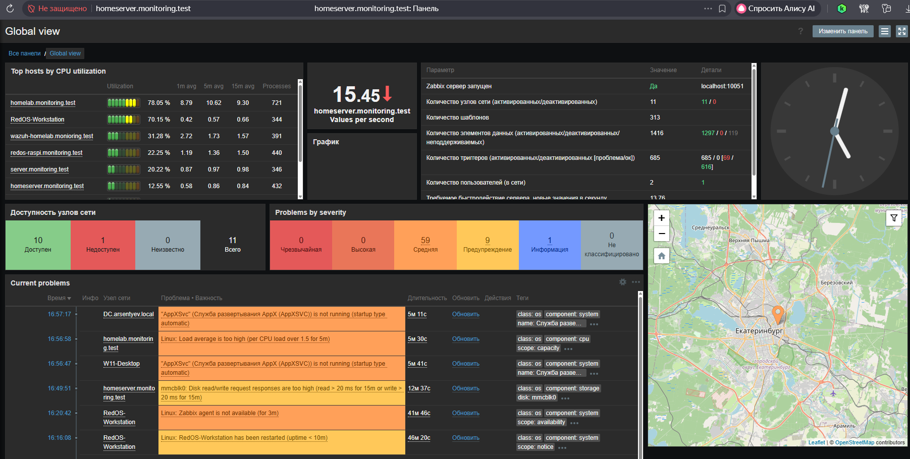

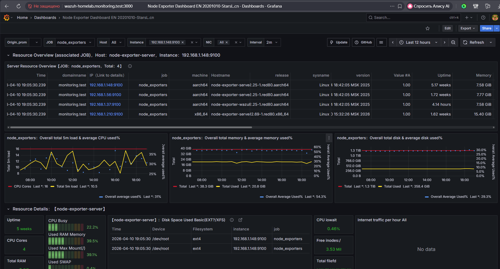

Observium занимает нишу «просто, мощно, бесплатно»: из коробки понимает тысячи
MIB-файлов (Cisco, Juniper, Linux, Windows…), сам находит интерфейсы, сенсоры и
LLDP-соседей, и не требует писать тонну скриптов.

## Архитектура

```
┌──────────────-┐  SNMP (UDP 161)   ┌─────────────────────────────┐
│  устройства   │ ────────────────> │ Observium (Docker, ARM64)   │
│ Linux/Windows │                   │  ├─ Apache + PHP 8.1        │
│ macOS/Keenetic│                   │  ├─ discovery + poller      │
└──────────────-┘                   │  └─ MariaDB (отдельный)     │
                                    └─────────────────────────────┘
```

Два контейнера: `observium` (веб + discovery/poller) и `db` (MariaDB 10.11),
объединённые сетью `observium-net`. Observium опрашивает устройства по SNMP и
хранит графики в RRD.

## Требования

- хост на **ARM64** (Raspberry Pi 4/5; на x86_64 — поменяй базовый образ в
  `Dockerfile` на `ubuntu:22.04`);
- Docker и Docker Compose;
- 1–2 ГБ свободной RAM, несколько ГБ на диске;
- свободный порт **10001** (веб-интерфейс).

## Быстрый старт

```bash
git clone https://github.com/ArsIS-02/docker-observium-arm64.git
cd docker-observium-arm64

cp .env.example .env
nano .env                    # смени пароли и OBSERVIUM_BASE_URL!

docker-compose up -d --build
docker-compose logs -f observium
```

Веб-интерфейс: **http://<IP-хоста>:10001**

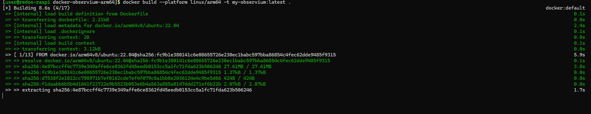

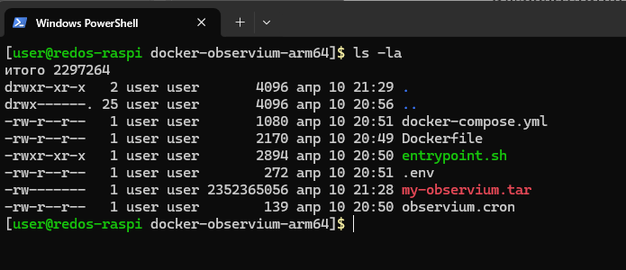

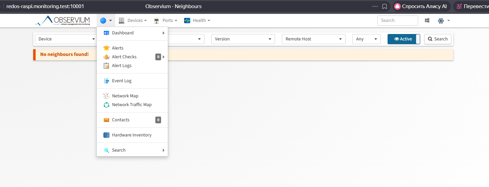

Сборка занимает ~20 минут (скачивается базовый образ Ubuntu + пакеты + архив
Observium). Итоговый образ — `my-observium:latest`.

## Файлы

| Файл | Назначение |
|---|---|
| `Dockerfile` | сборка Observium (Ubuntu 22.04 + Apache + PHP 8.1 + SNMP + RRDtool) |
| `docker-compose.yml` | Observium + MariaDB, порт 10001 |
| `entrypoint.sh` | ожидание БД, импорт схемы, создание админа, discovery/poller |
| `observium.cron` | расписание опроса (от www-data): poller каждые 5 мин, discovery каждые 6 мин |
| `snmpd.conf` | минимальный конфиг snmpd для устройств под наблюдением |
| `.env.example` | шаблон переменных окружения (скопируй в `.env`) |
| `data/ logs/ rrd/ hosts/` | тома (создаются при запуске) |

`entrypoint.sh` при старте: ждёт MariaDB → подставляет параметры в `config.php` →
импортирует схему (если БД пуста) → создаёт администратора через `adduser.php` →
выставляет права на `rrd/` и `logs/` для `www-data` → запускает первый discovery
и poller **от `www-data`** → стартует supervisor (Apache + cron).

## Настройка SNMP на устройствах

Observium общается с железом через SNMP — на каждом устройстве должен работать
SNMP-агент. Ключевой момент: community `public` (или своя), и для карты сети —
доступ ко всем MIB-веткам, включая LLDP.

### Linux (РЕД ОС и др.)

```bash
# РЕД ОС / Fedora
sudo dnf install net-snmp net-snmp-utils
# Debian / Ubuntu
sudo apt install snmpd snmp
```

Минимальный рабочий `/etc/snmp/snmpd.conf`:

```
rocommunity public default -V all
syslocation "Yekaterinburg, Russia"
syscontact admin@example.com
dontLogTCPWrappersConnects yes
```

> `-V all` даёт доступ ко всем MIB, включая LLDP, — без него Observium не увидит
> соседей и не построит карту сети.

```bash
sudo systemctl enable snmpd --now
snmpwalk -v2c -c public localhost system
```

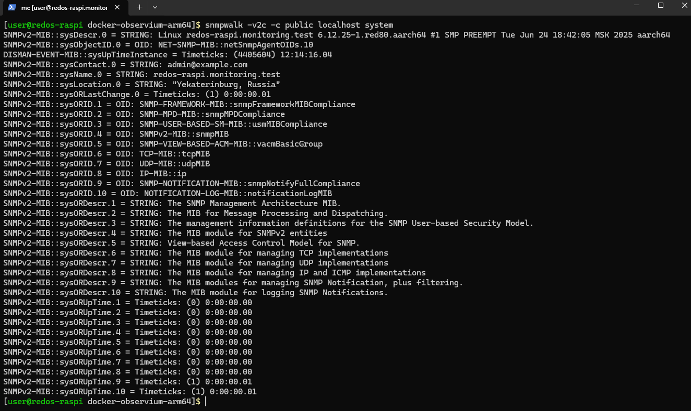

### Windows 10 / 11 / Server 2025

SNMP по умолчанию не установлен. Ставим компонент через PowerShell (от
администратора):

```powershell
Add-WindowsCapability -Online -Name "SNMP.Client~~~~0.0.1.0"
Add-WindowsCapability -Online -Name "WMI-SNMPProvider.Client~~~~0.0.1.0"
```

Перезагрузка → `services.msc` → **SNMP Service** → вкладка **Security**:

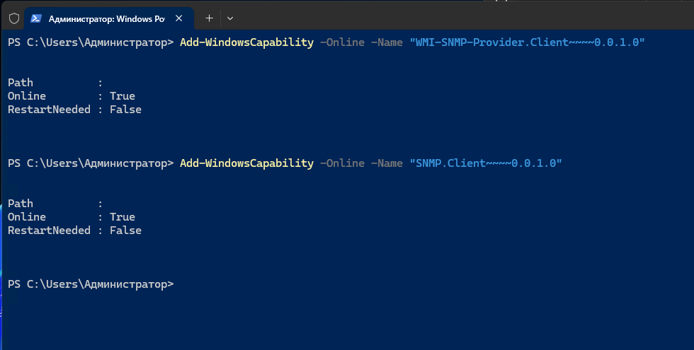

- добавь community `public` с правами **Read Only**;
- в списке **Accept SNMP packets from these hosts** укажи IP сервера Observium
  (пустой список = принимать от всех, для домашней лаборатории сойдёт).

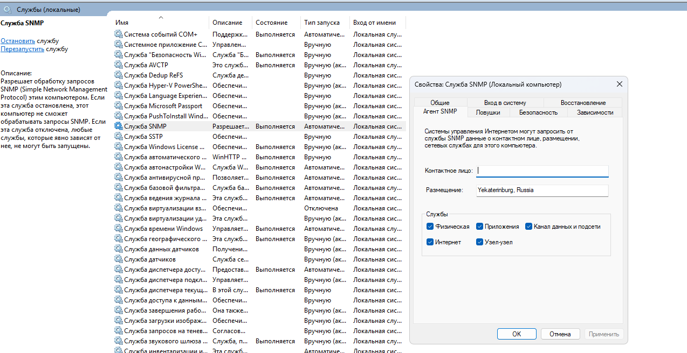

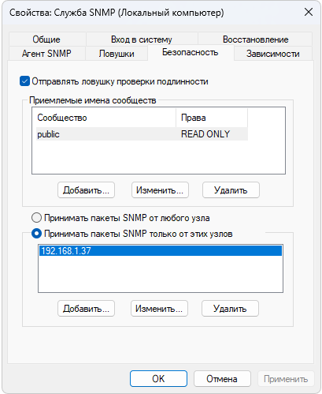

### macOS

SNMP-демон есть, но выключен. Включаем через `launchctl`:

```bash
sudo launchctl load -w /System/Library/LaunchDaemons/org.net-snmp.snmpd.plist
```

Конфиг `/etc/snmp/snmpd.conf` нужно создать вручную (по умолчанию его нет):

```
com2sec mynetwork 192.168.1.0/24 public
rocommunity public default -V all
syslocation "Yekaterinburg, Russia"
```

```bash
sudo launchctl unload -w /System/Library/LaunchDaemons/org.net-snmp.snmpd.plist
sudo launchctl load -w /System/Library/LaunchDaemons/org.net-snmp.snmpd.plist
snmpwalk -v2c -c public localhost system
```

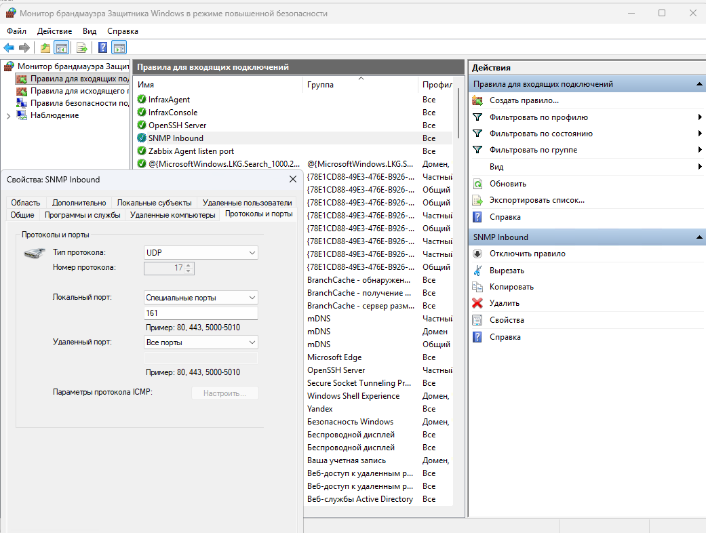

> В macOS нет многих MIB-файлов, поэтому часть OID недоступна. Для базовых метрик
> CPU, памяти и сети этого достаточно.

### Если SNMP не отвечает

- **Порт 161 закрыт фаерволом:**
  - Linux: `sudo firewall-cmd --add-port=161/udp --permanent && sudo firewall-cmd --reload`
  - Windows: создай правило для входящего UDP 161.

  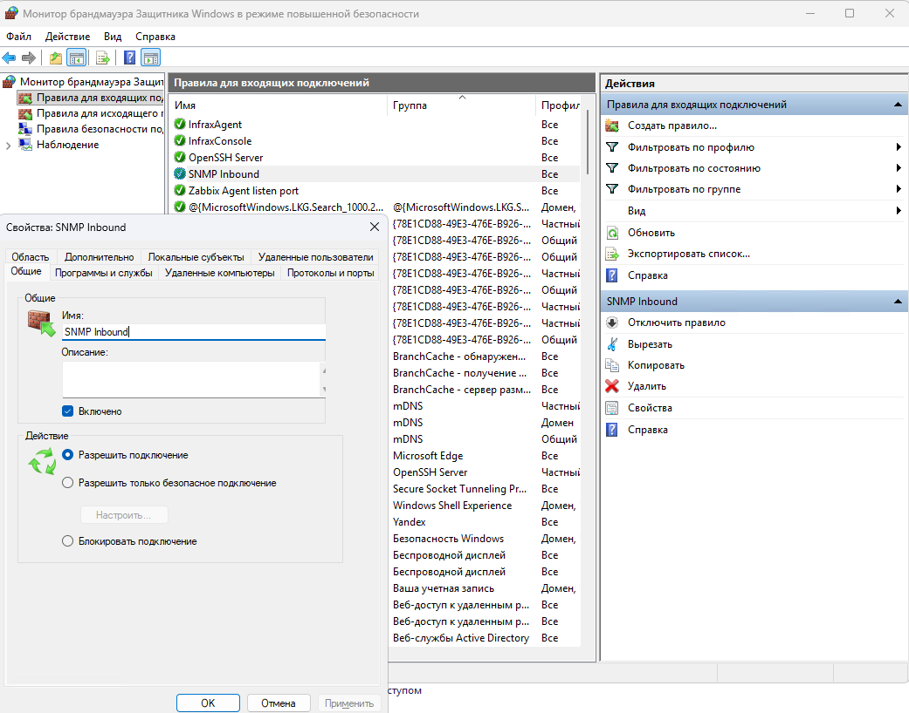

- **Community не совпадает** — везде должно быть одно значение (`public` или своё).
- **Не указан разрешённый IP** (Windows и часть Linux) — в `snmpd.conf` можно
  `rocommunity public <IP-сервера>` вместо `default`.
- **Служба не запущена** — `systemctl status snmpd` / состояние службы в Windows.

## Добавление устройств

### Через веб-интерфейс

**Devices → Add Device** → укажи:

- `Hostname` — IP или DNS-имя устройства;
- `SNMP Community` — `public` (или своя);
- `SNMP Version` — `v2c`.

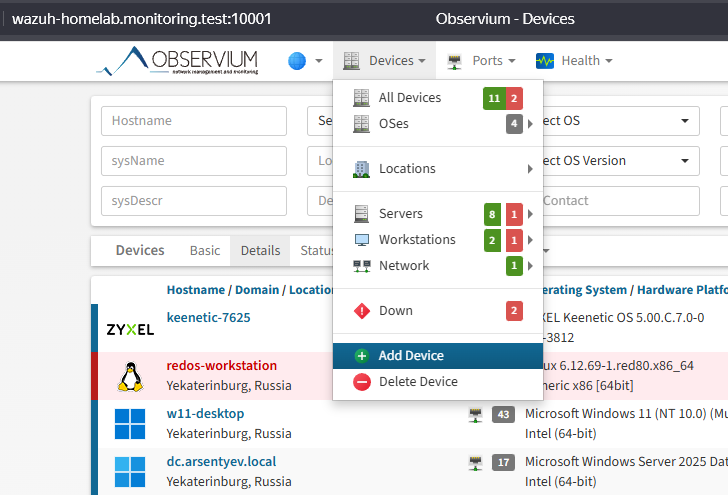

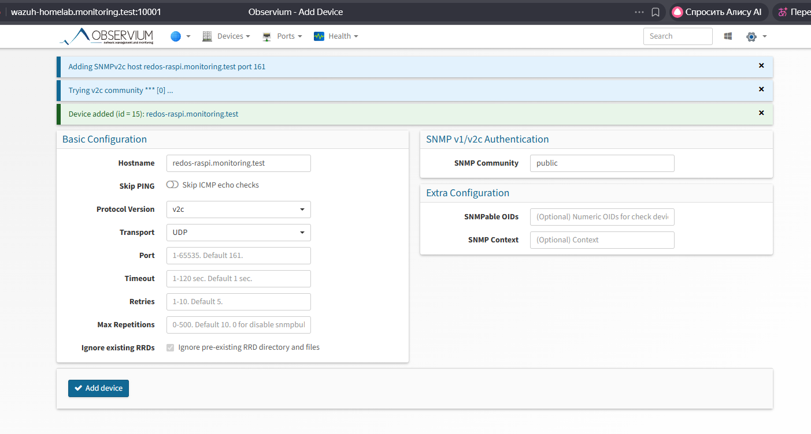

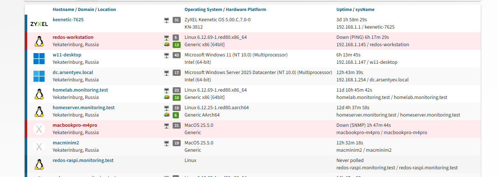

Данные подтянутся после первого poller-опроса (по умолчанию каждые 5 минут).
Ускорить:

```bash
docker exec observiumapp /opt/observium/discovery.php redos-raspi.monitoring.test -d
docker exec observiumapp /opt/observium/poller.php -h redos-raspi.monitoring.test -f
```

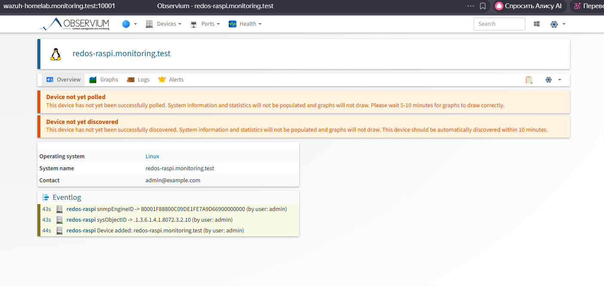

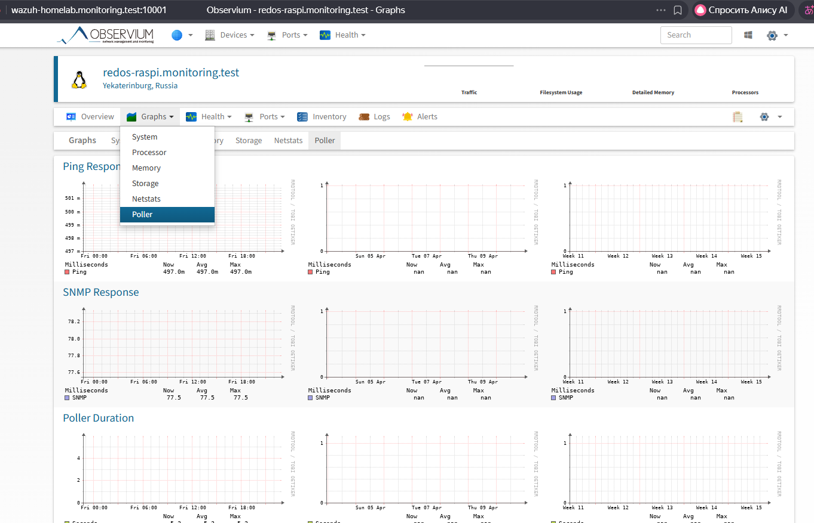

### Через командную строку

```bash
# одно устройство
docker exec observiumapp php /opt/observium/add_device.php <ip-адрес> public v2c

# массово из файла devices.txt (по строке: IP community version)
docker exec observiumapp php /opt/observium/add_device.php devices.txt
```

### Автообнаружение

Observium сам находит LLDP/CDP-соседей, если в `config.php` включить:

```php
$config['autodiscovery']['xdp'] = TRUE;
$config['autodiscovery']['ip_nets'] = array("192.168.1.0/24");
```

При следующем `discovery.php -h all` новые хосты добавятся сами. В разнородной
среде автодiscovery не всегда идеален, поэтому ручное добавление — основной способ.

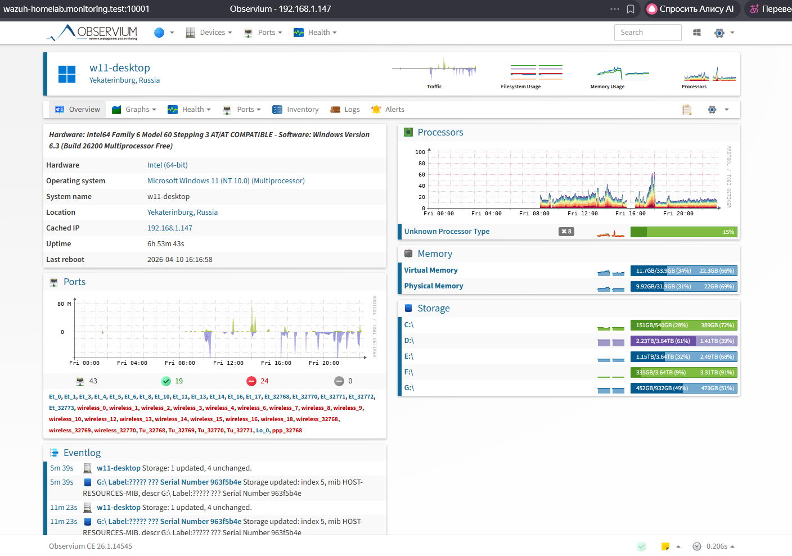

## Грабли

- **Графики не рисуются / ошибка на карточке** — раньше это был «танец с бубном»:
  опрос запускался от `root`, и RRD-файлы получали неправильного владельца. Сейчас
  discovery/poller работают от `www-data`, и права выставляются автоматически в
  `entrypoint.sh`. Если обновляешь **старую** установку — приведи права один раз:
  ```bash
  sudo chown -R 33:33 ./rrd
  ```
- **`no matching manifest`** на ARM — потому и собираем образ сами (этот репозиторий).
- **LLDP-соседи не видны** — в `snmpd.conf` не хватает `-V all`.
- **`.env` в публичном репо** — реальные секреты не коммитим: в репозитории лежит
  шаблон `.env.example`, а локальный `.env` добавлен в `.gitignore`.

## Результат

12 устройств — от Raspberry Pi и Keenetic до Windows 11 и macOS — в одном дашборде.
Графики CPU, памяти и трафика строятся сами, LLDP-соседи находятся, карта сети
вырисовывается.

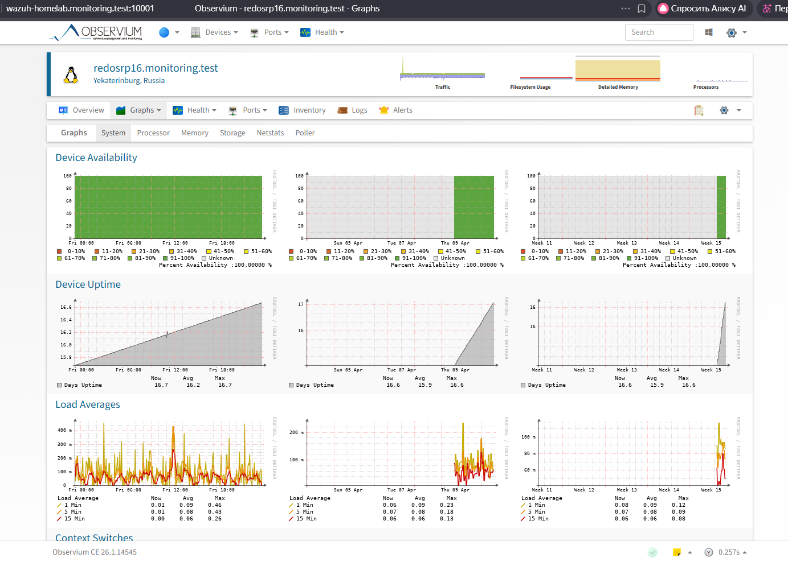

## Что дальше

- алерты по email / другим каналам;
- интеграция Syslog — логи роутера и серверов прямо в Observium;
- NetFlow/sFlow — кто жрёт трафик;
- доработка карты сети вручную или через LLDP.
